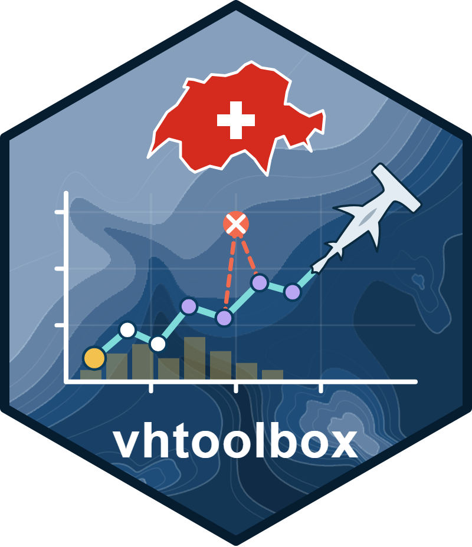

# vhtoolbox 

<!-- badges: start -->
[](https://lifecycle.r-lib.org/articles/stages.html#experimental)
[](https://www.gnu.org/licenses/gpl-3.0)
<!-- badges: end -->

**R toolbox by Vital Heim for movement ecology and telemetry, statistics, data wrangling and
visualisation.**

A growing collection of (mostly documented and hopefully) reusable R functions and scripts from my analyses of
animal movement data (e.g. satellite and acoustic telemetry of sharks): data cleaning and
filtering, spatial calculations, statistics and plotting. Whenever possible, functions are written so they work
with any data layout (column names are arguments).

New tools are added as they come up in projects.

## Installation

The functions are not a package yet. Just load them all with `source()`:

```r
fun_dir <- "path/to/vhtoolbox"
for (f in list.files(fun_dir, pattern = "^Rfun_.*\\.R$", full.names = TRUE)) source(f)
```

I do my best to document all functions in roxygen2 style. However, life, time constraints,
other projects, fieldwork, etc. may keep me from properly documenting functions, so
that fully documented versions of some functions may only be available at a later time.

## Available functions and scripts (to be continued)

### General (spatial) calculations

| Function | Description | Status |
|----------|-------------|--------|
| `convert_tz` | Quick timezone change if e.g. tagging data is local TZ but tracking equipment set to UTC | not documented |

### Movement & telemetry 1: Filtering, quality control, and simulation of Argos derived satellite tracking data

| Function | Description | Status |
|----------|-------------|--------|
| *(A) Pre-processing*|||
| `make_unique()` | Short wrapper to deal with near duplicate datetime-stamps when working with tracking data | not documented |
| `check_duplicated_ts()` | Find duplicated time stamps in datetime column of e.g. animal tracking data | not documented |
| *(B) Speed-distance-angle-filters* |||
| `sdafilter_plus()` | **Main function.** End-location check after `argosfilter::sdafilter()`; returns one filter status per location | documented |
| `sdafilter_ends()` | `argosfilter::sdafilter()` that keeps the angle result for rows 2 and n−1 (GPL, derived from argosfilter) | documented |
| *(C) State-space models (SSMs)* |||
| `import_sda_data()` | Function to find and select most recent (sda-filtered) datasets for SSM-input | documented |

<details>
<summary>Why an additional end-location check?</summary>

`argosfilter::sdafilter()` (Freitas et al. 2008) cannot test the first two and last two
locations of a track: its speed step needs two neighbours on each side, and it overwrites the
angle result for rows 2 and n−1 with `"end_location"`. Implausible end locations, e.g. the
first fix after tagging, therefore stay in the track. `sdafilter_plus()` applies the same two
tests to these locations (angle: argosfilter's own result; speed: root mean square over the neighbours
that exist). The first location (tagging location) is never tested.

```
argosfilter::sdafilter()                  separate step, run first
sdafilter_plus()
 ├─ sdafilter_ends()                      angle test, rows 2 and n−1
 └─ .argos_end_speed_check()  (internal)  speed test, rows 2, n−1, n
         └─ geosphere::distGeo()          (WGS84 distances)
```

Requirements: location class Z removed; at least 5 locations per individual; POSIXct
times; no NA in coordinates or times.
</details>

## Statistics

| Script | Description | Status |
|----------|-----------|--------|
|TBD | TBD | TBD |

## Data wrangling

| Function | Description | Status |
|----------|-------------|--------|
|TBD | TBD | TBD |

## Visualisation

| Script | Description | Status |
|----------|-----------|--------|
|TBD | TBD | TBD |

## Conventions

- **One function per file**, named `Rfun_<topic>_<name>.R` (e.g. `Rfun_sdafilter_plus.R`).
  Internal helpers start with a dot (`.prepare_track()`) and live in the file of the function
  that uses them.
- **Documentation in roxygen2 style** (`#' @param`, `@return`, `@examples`, `@references`)
- **Data columns in functions are arguments** (`lat = "lat"`, `datetime = "date"`), not fixed names.
- **No hidden global objects**: every parameter is an argument; species-specific values have
  no default.

**If you want to contribute to this repo you are very welcome to do so.**
Adding a function: write `Rfun_<topic>_<name>.R` → add an example → add a test to an
`eval_` script → add a row to the table above. Add your name to the authors list below.

## Dependencies

Depends on the functions used. Currently: [argosfilter](https://CRAN.R-project.org/package=argosfilter)
(tested with 0.70), [geosphere](https://CRAN.R-project.org/package=geosphere)

## Licence

[GNU General Public License v3.0](https://www.gnu.org/licenses/gpl-3.0) (GPL-3), see
`LICENSE`. You may use, modify and share the code; modified versions that are shared must
also be released under GPL-3.

## Third-party code

Some functions contain or are derived from code by other authors. Their copyright notices and
licences are kept in the file headers; changes are dated. Only code under GPL-3-compatible
licences (e.g. GPL >= 2, LGPL, MIT, BSD, Apache-2.0, CC BY-SA 4.0) or with the author's written
permission is included.

| Function | Original author | Source | Licence | Modified |
|----------|-----------------|--------|---------|----------|
| `sdafilter_ends()` | Carla Freitas | `argosfilter::sdafilter()`, [argosfilter](https://CRAN.R-project.org/package=argosfilter) 0.70 | GPL (>= 2) | yes: keeps the angle result for rows 2 and n−1 (2026-11-10); restyled, guard for < 3 locations (2026-11-12) |

Algorithms taken from publications (without copying code) are cited in the function
documentation and under [References](#references).

## References

- Freitas C, Lydersen C, Fedak MA, Kovacs KM (2008). A simple new algorithm to filter marine
  mammal Argos locations. *Marine Mammal Science* 24(2): 315–325.
  doi:10.1111/j.1748-7692.2007.00180.x
- Karney CFF (2013). Algorithms for geodesics. *Journal of Geodesy* 87: 43–55.
- McConnell BJ, Chambers C, Fedak MA (1992). Foraging ecology of southern elephant seals in
  relation to the bathymetry and productivity of the Southern Ocean. *Antarctic Science* 4:
  393–398.

## Author(s)

- Vital Heim (primary)
