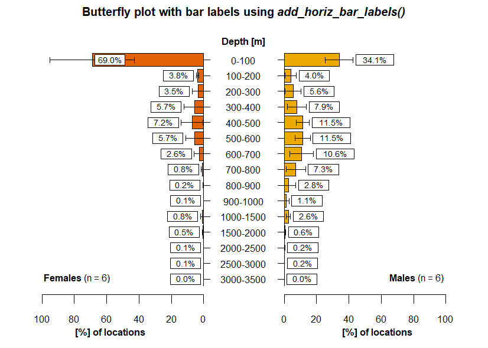

# Gallery

Example plots made with the vhtoolbox visualisation functions. All plots use simulated
data; the code for each image is in [`code/`](code/).

## `add_horiz_bar_labels()`

### Butterfly plot (two panels, reversed left axis)

Code: [`coming soon`](code/coming_soon.R)

### TBC